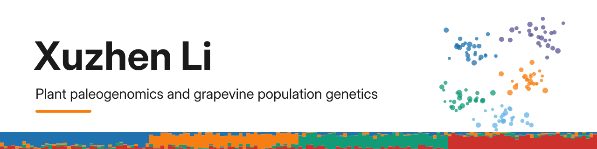
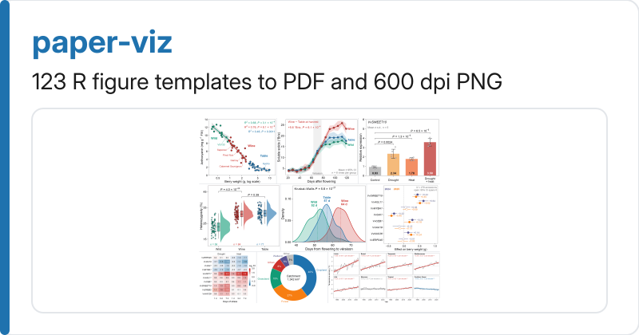
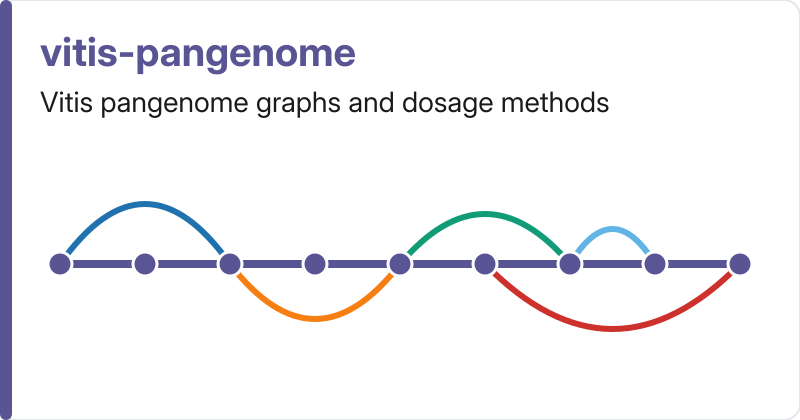
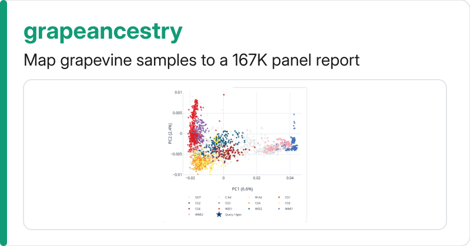
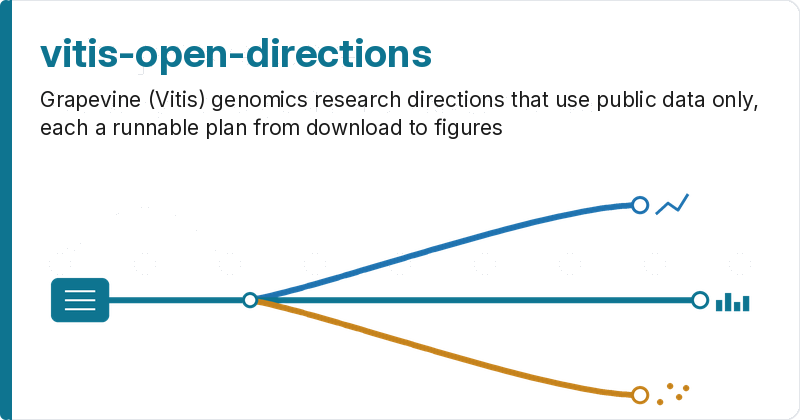

<picture>
  <source media="(prefers-color-scheme: dark)" srcset="assets/banner-dark.png">
  
</picture>

English | [中文](README.zh.md)

I study plant paleogenomics and the population genetics of grapevine and other perennial plants.

The public repositories here mostly contain pipelines and notes for Vitis pangenomes, gene annotation, capture-panel genotyping, and ancient DNA. There is also a publication-figure gallery and a few small analysis tools.

[ORCID 0000-0003-3670-6657](https://orcid.org/0000-0003-3670-6657) | [paper-viz gallery](https://xuzhen-li.github.io/paper-viz/) | [grapeancestry demo](https://xuzhen-li.github.io/grapeancestry/demo/results/ramos2019_np.batch.report.html)

## Featured

<table>
  <tr>
    <td width="50%">
      <a href="https://github.com/Xuzhen-Li/paper-viz">
        <picture>
          <source media="(prefers-color-scheme: dark)" srcset="assets/card-paper-viz-dark.png">
          
        </picture>
      </a> 
      Run the R figure templates in paper-viz to generate vector PDFs and 600 dpi PNGs. There is a browsable web gallery.
    </td>
    <td width="50%">
      <a href="https://github.com/Xuzhen-Li/vitis-pangenome">
        <picture>
          <source media="(prefers-color-scheme: dark)" srcset="assets/card-vitis-pangenome-dark.png">
          
        </picture>
      </a> 
      Scripts and workflows for Vitis pangenome graphs, presence/absence variation, and mixed-variant dosage analysis.
    </td>
  </tr>
  <tr>
    <td width="50%">
      <a href="https://github.com/Xuzhen-Li/gene-structure-annotation">gene-structure-annotation</a> 
      Build gene models and GFF3 files from a FASTA genome and supporting evidence.
    </td>
    <td width="50%">
      <a href="https://github.com/Xuzhen-Li/gene-function-annotation">gene-function-annotation</a> 
      Assign GO, KEGG, and domain labels to protein sequences after structure annotation.
    </td>
  </tr>
  <tr>
    <td width="50%">
      <a href="https://github.com/Xuzhen-Li/grapeancestry">
        <picture>
          <source media="(prefers-color-scheme: dark)" srcset="assets/card-grapeancestry-dark.png">
          
        </picture>
      </a> 
      Map new grapevine samples to a frozen 167K capture panel and write interactive HTML reports.
    </td>
    <td width="50%">
      <a href="https://github.com/Xuzhen-Li/vitis-open-directions">
        <picture>
          <source media="(prefers-color-scheme: dark)" srcset="assets/card-vitis-open-directions-dark.png">
          
        </picture>
      </a> 
      Grapevine (Vitis) genomics research directions that use public data only, each a runnable plan from download to figures
    </td>
  </tr>
</table>

## Research lines

| Topic | Repositories |
| --- | --- |
| Pangenome and grapevine genomes | [vitis-pangenome](https://github.com/Xuzhen-Li/vitis-pangenome); [grapevine-plastid](https://github.com/Xuzhen-Li/grapevine-plastid) (in progress); [vitis-te](https://github.com/Xuzhen-Li/vitis-te) (in progress) |
| Genome annotation | [gene-structure-annotation](https://github.com/Xuzhen-Li/gene-structure-annotation); [gene-function-annotation](https://github.com/Xuzhen-Li/gene-function-annotation) |
| Population genetics | [qbar](https://github.com/Xuzhen-Li/qbar); [TrioConcordance](https://github.com/Xuzhen-Li/TrioConcordance); [genomics-theory-mining](https://github.com/Xuzhen-Li/genomics-theory-mining); [vitis-popgen](https://github.com/Xuzhen-Li/vitis-popgen), a methods catalogue for *Vitis* population structure, gene flow, domestication, selection, demography, and related analyses on public or published data |
| Capture-panel genotyping | [grapeancestry](https://github.com/Xuzhen-Li/grapeancestry); [grapevine-chip](https://github.com/Xuzhen-Li/grapevine-chip); [gtbs-chip-service-kit](https://github.com/Xuzhen-Li/gtbs-chip-service-kit) |
| Ancient DNA | [grapevine-adna](https://github.com/Xuzhen-Li/grapevine-adna), a methods catalogue for *Vitis* ancient DNA, covering sampling, clean-room practice, extraction, library preparation, capture or shotgun sequencing, preprocessing, mapping, damage authentication, contamination, low-coverage genotyping, dating, and downstream analyses alongside modern grapes |
| Open directions | [vitis-open-directions](https://github.com/Xuzhen-Li/vitis-open-directions), grapevine (*Vitis*) genomics research directions that use public data only, each a runnable plan from download to figures |

## Tools and skills

| Repository | What it does |
| --- | --- |
| [paper-viz](https://github.com/Xuzhen-Li/paper-viz) | R figure templates and schematics with code, simulated data, previews, and a web gallery. |
| [paper-reading](https://github.com/Xuzhen-Li/paper-reading) | Convert a local research PDF into an illustrated reading note in Chinese. Your PDF library remains local on your machine. |
| [literature-review-skills](https://github.com/Xuzhen-Li/literature-review-skills) | A literature-review skill suite that pauses at human checkpoints, tying every claim to a source held in the project. |
| [patent-drafting-skills](https://github.com/Xuzhen-Li/patent-drafting-skills) | Bilingual (Chinese and English) agent skills for drafting invention patents (CN, US, and PCT) and exporting .docx files. |
| [concept-learning](https://github.com/Xuzhen-Li/concept-learning) | A Cursor skill for writing biology concept lessons and short teaching series. |
| [famous-people](https://github.com/Xuzhen-Li/famous-people) | A Cursor skill that writes a biologist's scientific career as a long-form Chinese article. |
| [awesome-astra-science](https://github.com/Xuzhen-Li/awesome-astra-science) | A collection of demos and figures actually generated by AI models. |
| [cursor-state-vscdb](https://github.com/Xuzhen-Li/cursor-state-vscdb) | Notes and scripts for diagnosing macOS Cursor freezes caused by an oversized state.vscdb SQLite file. |
| [multi-bot-agent-framework](https://github.com/Xuzhen-Li/multi-bot-agent-framework) | A Cursor skill for assigning one role at a time across a shared bot pool. |

## Contact

[ORCID 0000-0003-3670-6657](https://orcid.org/0000-0003-3670-6657)
