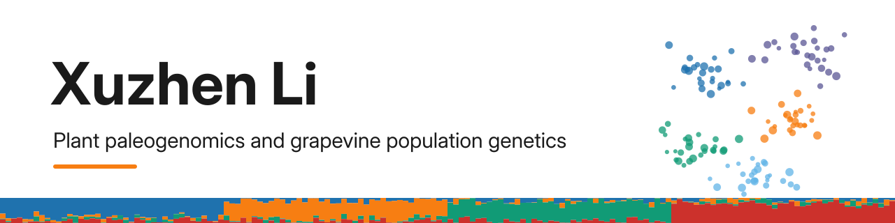
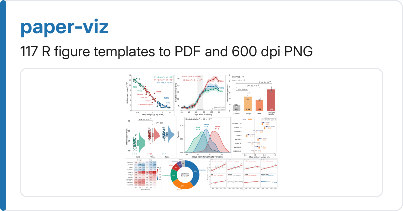
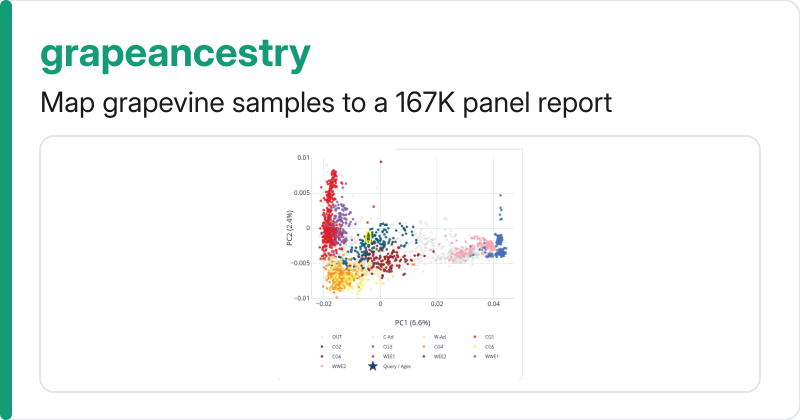
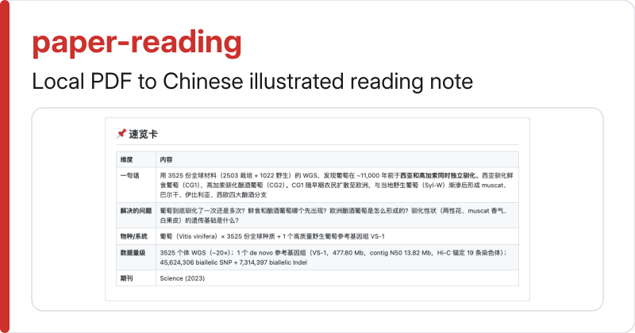
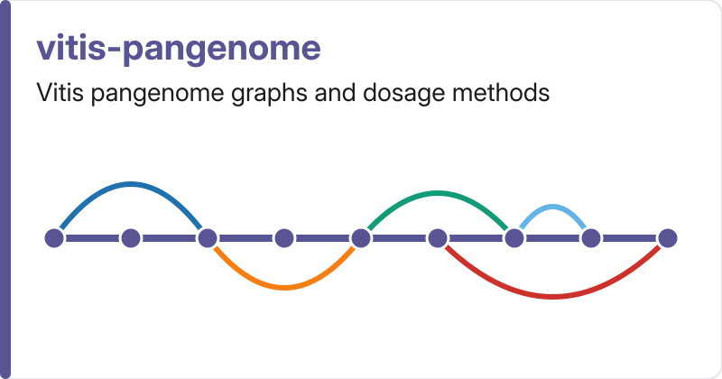
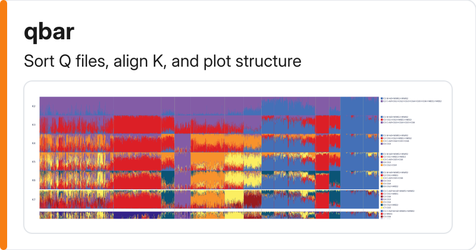
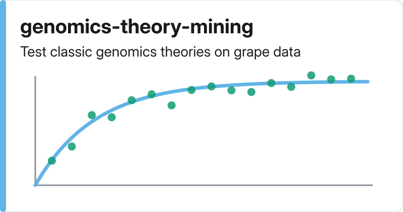

<picture>
  <source media="(prefers-color-scheme: dark)" srcset="assets/banner-dark.png">
  
</picture>

我开发分析流程并研究葡萄基因组，关注无性繁殖系、泛基因组、转座子、靶向测序面板、古DNA与群体遗传学理论。

[ORCID 0000-0003-3670-6657](https://orcid.org/0000-0003-3670-6657) | [paper-viz gallery](https://xuzhen-li.github.io/paper-viz/) | [grapeancestry demo](https://xuzhen-li.github.io/grapeancestry/demo/results/ramos2019_np.batch.report.html)

<table>
  <tr>
    <td width="50%">
      <a href="https://github.com/Xuzhen-Li/paper-viz">
        <picture>
          <source media="(prefers-color-scheme: dark)" srcset="assets/card-paper-viz-dark.png">
          
        </picture>
      </a> 
      运行117个R语言绘图模板，生成矢量PDF和600 dpi的PNG图。
    </td>
    <td width="50%">
      <a href="https://github.com/Xuzhen-Li/grapeancestry">
        <picture>
          <source media="(prefers-color-scheme: dark)" srcset="assets/card-grapeancestry-dark.png">
          
        </picture>
      </a> 
      将新的葡萄样本映射至2449 × 167K靶向捕获面板，并生成交互式HTML报告。
    </td>
  </tr>
  <tr>
    <td width="50%">
      <a href="https://github.com/Xuzhen-Li/paper-reading">
        <picture>
          <source media="(prefers-color-scheme: dark)" srcset="assets/card-paper-reading-dark.png">
          
        </picture>
      </a> 
      将本地研究PDF转换为中文图文阅读笔记，文件保留在本地。
    </td>
    <td width="50%">
      <a href="https://github.com/Xuzhen-Li/vitis-pangenome">
        <picture>
          <source media="(prefers-color-scheme: dark)" srcset="assets/card-vitis-pangenome-dark.png">
          
        </picture>
      </a> 
      运行葡萄泛基因组图谱、存在与缺失变异以及混合变异剂量分析流程。
    </td>
  </tr>
  <tr>
    <td width="50%">
      <a href="https://github.com/Xuzhen-Li/qbar">
        <picture>
          <source media="(prefers-color-scheme: dark)" srcset="assets/card-qbar-dark.png">
          
        </picture>
      </a> 
      排序ADMIXTURE Q文件，在不同K值间对齐列，并绘制群体结构柱状图。
    </td>
    <td width="50%">
      <a href="https://github.com/Xuzhen-Li/genomics-theory-mining">
        <picture>
          <source media="(prefers-color-scheme: dark)" srcset="assets/card-genomics-theory-mining-dark.png">
          
        </picture>
      </a> 
      挖掘经典基因组学理论，并在现代葡萄无性繁殖系和野生葡萄数据上测试其假设。
    </td>
  </tr>
</table>

### 研究方向

| 主题 | 仓库 |
| --- | --- |
| 葡萄基因组 | [vitis-te](https://github.com/Xuzhen-Li/vitis-te) (待更新流程), [grapevine-plastid](https://github.com/Xuzhen-Li/grapevine-plastid) (待更新方法) |
| 基因组注释 | [gene-structure-annotation](https://github.com/Xuzhen-Li/gene-structure-annotation), [gene-function-annotation](https://github.com/Xuzhen-Li/gene-function-annotation) |
| 靶向测序基因分型 | [gtbs-chip-service-kit](https://github.com/Xuzhen-Li/gtbs-chip-service-kit), [grapevine-chip](https://github.com/Xuzhen-Li/grapevine-chip) (设计笔记) |
| 群体遗传学 | [vitis-popgen](https://github.com/Xuzhen-Li/vitis-popgen) (预留项), [TrioConcordance](https://github.com/Xuzhen-Li/TrioConcordance) |
| 古DNA | [grapevine-adna](https://github.com/Xuzhen-Li/grapevine-adna) (预留项) |

更多仓库

- [concept-learning](https://github.com/Xuzhen-Li/concept-learning): 生物学概念课程与BioLogos风格系列写作 (Cursor skill)。
- [famous-people](https://github.com/Xuzhen-Li/famous-people): 将生物学家的科研生涯转为微信长文记录 (Cursor skill)。
- [awesome-astra-science](https://github.com/Xuzhen-Li/awesome-astra-science): AI模型作品集，按模型实际生成的示例与图表分类。
- [cursor-state-vscdb](https://github.com/Xuzhen-Li/cursor-state-vscdb): 用于诊断因巨型状态数据库导致macOS Cursor卡顿的脚本与案例。
- [grok-bot-dispatch](https://github.com/Xuzhen-Li/grok-bot-dispatch): 前置分发机器人的Cursor skill，项目机器人保持未分配状态。

