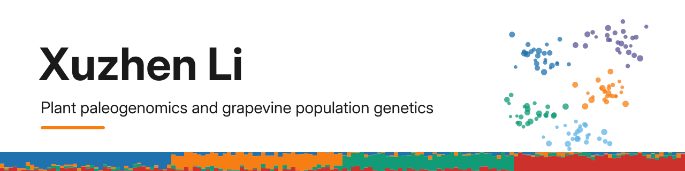
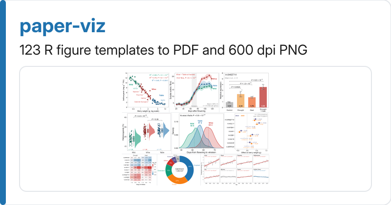
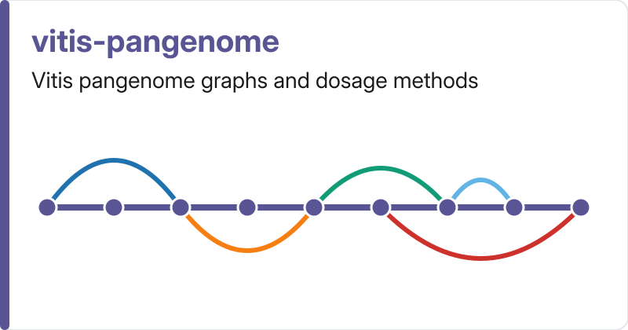
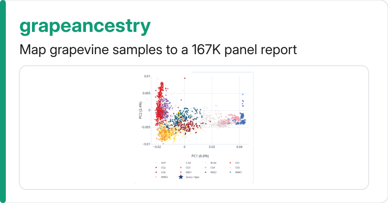
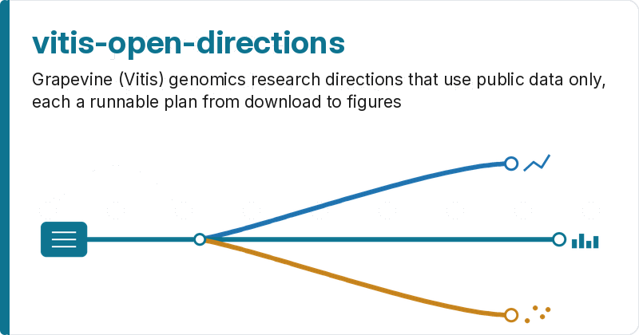

<picture>
  <source media="(prefers-color-scheme: dark)" srcset="assets/banner-dark.png">
  
</picture>

[English](README.md) | 中文

我研究植物古基因组学，以及葡萄和其他多年生植物的群体遗传学。

这里的公开仓库主要包含 Vitis 泛基因组、基因注释、捕获面板基因分型和古 DNA 的分析流程与笔记。此外还有一个论文配图库和几个小型分析工具。

[ORCID 0000-0003-3670-6657](https://orcid.org/0000-0003-3670-6657) | [paper-viz 图库](https://xuzhen-li.github.io/paper-viz/) | [grapeancestry 演示](https://xuzhen-li.github.io/grapeancestry/demo/results/ramos2019_np.batch.report.html)

## 精选项目

<table>
  <tr>
    <td width="50%">
      <a href="https://github.com/Xuzhen-Li/paper-viz">
        <picture>
          <source media="(prefers-color-scheme: dark)" srcset="assets/card-paper-viz-dark.png">
          
        </picture>
      </a> 
      运行 paper-viz 中的 R 绘图模板，生成矢量 PDF 和 600 dpi PNG。另有可浏览的网页图库。
    </td>
    <td width="50%">
      <a href="https://github.com/Xuzhen-Li/vitis-pangenome">
        <picture>
          <source media="(prefers-color-scheme: dark)" srcset="assets/card-vitis-pangenome-dark.png">
          
        </picture>
      </a> 
      用于 Vitis 泛基因组图、存在/缺失变异及混合变异剂量分析的脚本与工作流。
    </td>
  </tr>
  <tr>
    <td width="50%">
      <a href="https://github.com/Xuzhen-Li/gene-structure-annotation">gene-structure-annotation</a> 
      基于 FASTA 基因组及支持证据构建基因模型并生成 GFF3 文件。
    </td>
    <td width="50%">
      <a href="https://github.com/Xuzhen-Li/gene-function-annotation">gene-function-annotation</a> 
      在结构注释之后为蛋白质序列分配 GO、KEGG 和结构域标签。
    </td>
  </tr>
  <tr>
    <td width="50%">
      <a href="https://github.com/Xuzhen-Li/grapeancestry">
        <picture>
          <source media="(prefers-color-scheme: dark)" srcset="assets/card-grapeancestry-dark.png">
          
        </picture>
      </a> 
      将新的葡萄样本映射到冻结的 167K 捕获面板，并写出交互式 HTML 报告。
    </td>
    <td width="50%">
      <a href="https://github.com/Xuzhen-Li/vitis-open-directions">
        <picture>
          <source media="(prefers-color-scheme: dark)" srcset="assets/card-vitis-open-directions-dark.png">
          
        </picture>
      </a> 
      仅使用公开数据的葡萄（Vitis）基因组学研究方向，每个都是从下载到出图的可运行方案
    </td>
  </tr>
</table>

## 研究方向

| 主题 | 仓库 |
| --- | --- |
| 泛基因组与葡萄基因组 | [vitis-pangenome](https://github.com/Xuzhen-Li/vitis-pangenome)；[grapevine-plastid](https://github.com/Xuzhen-Li/grapevine-plastid)（进行中）；[vitis-te](https://github.com/Xuzhen-Li/vitis-te)（进行中） |
| 基因组注释 | [gene-structure-annotation](https://github.com/Xuzhen-Li/gene-structure-annotation)；[gene-function-annotation](https://github.com/Xuzhen-Li/gene-function-annotation) |
| 群体遗传学 | [qbar](https://github.com/Xuzhen-Li/qbar)；[TrioConcordance](https://github.com/Xuzhen-Li/TrioConcordance)；[genomics-theory-mining](https://github.com/Xuzhen-Li/genomics-theory-mining)；[vitis-popgen](https://github.com/Xuzhen-Li/vitis-popgen)，面向公开或已发表数据的 *Vitis* 群体结构、基因流、驯化、选择、群体历史及相关分析的方法目录 |
| 捕获面板基因分型 | [grapeancestry](https://github.com/Xuzhen-Li/grapeancestry)；[grapevine-chip](https://github.com/Xuzhen-Li/grapevine-chip)；[gtbs-chip-service-kit](https://github.com/Xuzhen-Li/gtbs-chip-service-kit) |
| 古 DNA | [grapevine-adna](https://github.com/Xuzhen-Li/grapevine-adna)，*Vitis* 古 DNA 方法目录，涵盖采样、超净室操作、提取、文库制备、捕获或鸟枪法测序、预处理、比对、损伤鉴定、污染、低深度基因分型、测年以及与现代葡萄一起做的下游分析 |
| 开放研究方向 | [vitis-open-directions](https://github.com/Xuzhen-Li/vitis-open-directions)，仅使用公开数据的葡萄（*Vitis*）基因组学研究方向，每个都是从下载到出图的可运行方案 |

## 工具与技能

| 仓库 | 功能简介 |
| --- | --- |
| [paper-viz](https://github.com/Xuzhen-Li/paper-viz) | R 绘图模板与示意图，附带代码、模拟数据、预览及网页图库。 |
| [paper-reading](https://github.com/Xuzhen-Li/paper-reading) | 将一份本地科研 PDF 转换成带插图的中文阅读笔记。你的 PDF 文献库仍留在你的机器本地。 |
| [literature-review-skills](https://github.com/Xuzhen-Li/literature-review-skills) | 在人工检查点暂停的文献综述技能套件，将每项论断与项目中保存的来源关联。 |
| [patent-drafting-skills](https://github.com/Xuzhen-Li/patent-drafting-skills) | 用于撰写发明专利（CN、US 及 PCT）并导出 .docx 文件的中英双语智能体技能。 |
| [concept-learning](https://github.com/Xuzhen-Li/concept-learning) | 用于编写生物学概念课与简短教学系列的 Cursor 技能。 |
| [famous-people](https://github.com/Xuzhen-Li/famous-people) | 将一位生物学家的科研生涯撰写为中文长文的 Cursor 技能。 |
| [awesome-astra-science](https://github.com/Xuzhen-Li/awesome-astra-science) | 实际由 AI 模型生成的演示与图表合集。 |
| [cursor-state-vscdb](https://github.com/Xuzhen-Li/cursor-state-vscdb) | 用于诊断因 state.vscdb SQLite 文件过大导致的 macOS 版 Cursor 冻结的笔记与脚本。 |
| [multi-bot-agent-framework](https://github.com/Xuzhen-Li/multi-bot-agent-framework) | 用于在共享 bot 池中每次分配一个角色的 Cursor 技能。 |

## 联系方式

[ORCID 0000-0003-3670-6657](https://orcid.org/0000-0003-3670-6657)
